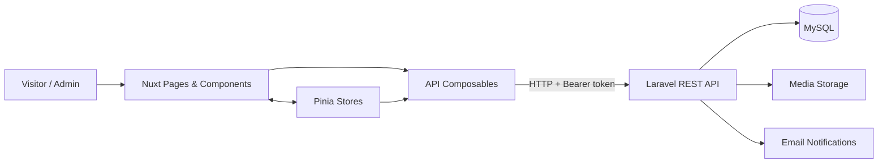

# metCasa — Real Estate Platform

**A full-stack real estate application built with Nuxt and Laravel.**

metCasa helps people explore properties for sale or rent in Iași and nearby areas. Visitors can narrow their search with detailed filters, explore photos and property information, and contact owners. Registered users can save properties and manage their accounts, while administrators can maintain the property catalog.

This repository contains the **Nuxt frontend**. It communicates with a separate **Laravel REST API** that handles authentication, permissions, listings, favorites, notifications, and file storage.

**[Frontend repository](https://github.com/biancabojescu/metcasa)** · **[Backend repository](https://github.com/biancabojescu/metcasa-api)**

## Features

- **Property discovery:** browse listings for sale or rent; filter by location, property type, rooms, price, and floor area; sort results and navigate paginated results.
- **Shareable searches:** search filters, sorting, and pagination stay synchronized with the URL, including during browser back/forward navigation.
- **Property details:** view photo galleries, specifications, asking prices, contact information, and a link to locate the property on Google Maps.
- **User accounts:** register, log in, verify email addresses, recover passwords, and update profile information or avatars.
- **Saved properties:** add or remove favorites and revisit them across sessions.
- **Administration:** authorized super admins can create, edit, archive, and delete listings, as well as manage their images.
- **Responsive experience:** layouts adapt to smaller screens, including mobile-friendly filters, loading placeholders, and informative empty states.

## Tech Stack

| Frontend (this repository) | Backend (separate repository) |
| --- | --- |
| Nuxt 4, Vue 3, TypeScript | PHP, Laravel 13 |
| Pinia, Nuxt UI, Tailwind CSS 4 | Laravel Sanctum, Spatie Permission |
| pnpm, ESLint, Prettier | MySQL, Eloquent, Laravel filesystem |

## Technical Highlights

### URL-synchronized property search

Filters, sorting, and pagination are reflected in the URL, so searches can be shared and restored through browser navigation. A Pinia store coordinates search controls with API parameters, while server-side filtering and pagination keep the client from loading the entire property catalog.

### Authentication and session state

A centralized API composable sends authenticated requests to Laravel, while a Pinia store manages user state and restores sessions through the API. Route middleware distinguishes guest-only screens, authenticated areas, and the super-admin dashboard. The backend independently enforces permissions for protected operations.

### Favorites that remain consistent with the API

The frontend maintains saved property IDs separately from paginated property details. This lets listing cards show favorite state without fetching the full saved catalog. Updates use the API response as the source of truth, including when saved listings are no longer active.

### Property image management

Administrative forms support previews and multipart uploads. During updates, the frontend sends retained image paths separately from new uploads, allowing the backend to preserve, add, or remove images as appropriate.

## Architecture

The frontend is a client-rendered Nuxt application (`ssr: false`) with file-based routing, Pinia state, and shared API composables. The backend exposes JSON and multipart endpoints under `/api/v1`.



The main frontend folders are `app/pages/` for routes, `app/components/` for reusable UI, `app/stores/` for state, `app/composables/` for API access, and `app/middleware/` for route guards.

## Getting Started

You will need **Node.js `^20.19.0` or `>=22.12.0`**, **pnpm 10.33.2**, and a running compatible instance of the [metCasa Laravel API](https://github.com/biancabojescu/metcasa-api).

### 1. Set up the frontend

```bash
git clone https://github.com/biancabojescu/metcasa.git
cd metcasa
pnpm install
```

Create `.env` from `.env.example` and configure the local API address:

```dotenv
API_URL=http://localhost:8000/api/v1
BASE_URL=http://localhost:3001
```

Start the frontend:

```bash
pnpm dev
```

Open **http://localhost:3001**. Features involving accounts or properties require the backend to be running.

<details>
<summary><strong>Set up the Laravel backend locally</strong></summary>


The backend is in a [separate repository](https://github.com/biancabojescu/metcasa-api). You will need PHP 8.3+, Composer, and MySQL.

```bash
git clone https://github.com/biancabojescu/metcasa-api.git
cd metcasa-api
composer install
```

Copy `.env.example` to `.env`, create a local MySQL database, and configure values for your environment:

```dotenv
APP_URL=http://localhost:8000
FRONTEND_URL=http://localhost:3001
FRONTEND_ORIGINS=http://localhost:3001,http://127.0.0.1:3001
DB_CONNECTION=mysql
DB_HOST=127.0.0.1
DB_PORT=3306
DB_DATABASE=metcasa_api
DB_USERNAME=your_database_user
DB_PASSWORD=your_database_password
MAIL_MAILER=log
```

Then run:

```bash
php artisan key:generate
php artisan migrate
php artisan db:seed --class=RolesAndPermissionsSeeder
php artisan storage:link
php artisan serve --host=localhost --port=8000
```

To access the super-admin dashboard, assign the role to an account you registered locally. In the backend project, run `php artisan tinker` and replace the email below:

```php
$user = App\Models\User::where('email', 'developer@example.com')->firstOrFail();
$user->assignRole('super admin');
```

Log out and log back in to refresh permissions. With `MAIL_MAILER=log`, email verification and password reset messages can be inspected in `storage/logs/laravel.log` rather than delivered to a real inbox.

These instructions are based on the repository configuration; they have not been executed as part of this README rewrite.

</details>

### Production build

```bash
pnpm build
pnpm preview
```

For deployment, configure the correct API URL and allow the deployed frontend origin in the backend's CORS settings.

## Usage

1. Open the property catalog at `/anunturi` and filter or sort listings.
2. Select a listing to see its photos, details, and owner contact information.
3. Register or sign in to save properties to favorites.
4. Manage saved listings and account details from your profile.
5. If you have a `super admin` account, open `/dashboard` to manage listings and images.

## Development Checks

The frontend currently has no automated application test suite. Available checks include:

```bash
pnpm typecheck
pnpm lint
pnpm format:check
```

**Note:** The inspected ESLint configuration references dependencies that may need to be declared explicitly for linting to work after a fresh install.

## Current Limitations

This project is a portfolio application, not a production-hardened real estate service. Areas to improve include automated test coverage, server-side rendering and listing metadata for SEO, paginated administration statistics, and more robust handling of concurrent search requests.

Authentication tokens are currently stored in `localStorage`. Session expiry handling, token storage strategy, and backend authorization policies should be reviewed before production deployment. Inactive property visibility and email-verification enforcement also require additional backend safeguards if those restrictions are expected.
